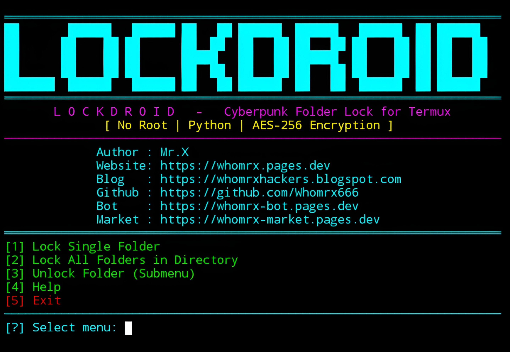

# Lockdroid


<p align="center">
  <strong>Cyberpunk Folder Lock for Termux – No Root | Python | AES-256 Encryption</strong><br>
  <em>"Keep your secrets encrypted in the neon shadows." – Mr.X</em>
</p>

## Introduction
Lockdroid is a folder locking tool designed for **Termux (Android)** that requires **no root**. It compresses your folder contents and encrypts them using **AES-256-CBC** with **PBKDF2** key derivation, ensuring strong protection for your private files. The original folder remains visible but is emptied and replaced with a marker file explaining the lock status. Encrypted data is stored as a `.lockdroid` file inside a dedicated `Lockdroid` directory. Lockdroid runs smoothly on Termux, Linux, Windows, and macOS (any system with Python and OpenSSL).

## Installation
```bash
$ pkg update -y && pkg upgrade -y
$ pkg install git python openssl-tool -y
$ git clone https://github.com/Whomrx666/Lockdroid.git
$ cd Lockdroid
$ python3 install.py
```

## Run manually
```bash
$ python3 lockdroid.py
```

## Features
- **AES-256-CBC Encryption** – Strong symmetric encryption with PBKDF2 key derivation.
- **No Root Required** – Works on Termux and standard Linux/macOS/Windows Python.
- **Compression Before Encryption** – Uses tar.gz to reduce file size and hide structure.
- **Folder Lock / Unlock** – Lock single folder or all subfolders in a directory.
- **Unlock Options** – Unlock a single `.lockdroid` file, all files in a directory, or selected files.
- **Recursive Locked Folder Detection** – Scan directory trees to find folders locked by Lockdroid.
- **Metadata Recovery** – Restores original folder location automatically via `.meta` file.
- **Cyberpunk UI** – Neon colors, centered banner, dynamic separators, loading animation.
- **Interactive Menu** – Easy-to-use numbered menus with submenu support.
- **Secure Password Input** – Uses `getpass` to hide password during entry.
- **Help & Documentation** – Built-in help with usage, warnings, and tips.

## Menu Options
| #  | Option | Description |
|----|--------|-------------|
| 1  | Lock Single Folder | Encrypt and lock one specific folder |
| 2  | Lock All Folders in Directory | Lock all subfolders (one level) in a parent directory |
| 3  | Unlock Folder (Submenu) | Open unlock submenu with multiple options |
| 4  | Help | Show detailed help and usage guide |
| 5  | Exit | Quit the program |

### Unlock Submenu
| #  | Option | Description |
|----|--------|-------------|
| 1  | Unlock Single .lockdroid File | Decrypt one lock file |
| 2  | Unlock All .lockdroid Files in Directory | Unlock all lock files in a folder |
| 3  | Unlock Selected .lockdroid Files | Choose specific lock files to unlock |
| 4  | Detect Locked Folders (Recursive) | Scan directory tree for locked folders |
| 5  | Back to Main Menu | Return to main menu |

## Instructions
1. **Install** the tool using the commands above.
2. **Run** `python3 lockdroid.py` to start the interactive menu.
3. **Lock a folder**:
   - Choose option `1` and enter the full path of the folder you want to lock.
   - Create a password (minimum 6 characters) and confirm it.
   - The folder contents will be encrypted and stored as `.lockdroid` file inside the `Lockdroid` directory.
4. **Unlock a folder**:
   - Choose option `3` to open the unlock submenu.
   - Select the appropriate unlock method (single, all, selected, or detection).
   - Provide the password and follow the prompts.
5. **Help** – Use option `4` for detailed instructions, examples, warnings, and tips.
6. **Exit** – Use option `5` to close the program safely.

## Observation
This tool is intended for **personal data protection and educational purposes only**. Always back up your important data before locking folders. **There is no password recovery** – if you forget your password, your data cannot be recovered. The author assumes no responsibility for data loss or misuse of this tool.

### Original Author
<a href="https://github.com/Whomrx666"></a>

### <<< If you copy, then give me the credits >>>

## CONNECT WITH ME :

[](https://whomrx.pages.dev)
[](https://whomrxhackers.blogspot.com)
[](https://twitter.com/whomrx666)
[](https://wa.me/6285926601133?text=Halo%2C%20Mr.X)
[](https://www.facebook.com/whomrx.666)
[](https://t.me/Whomr_X)
[](mailto:whomrx666@gmail.com)
[](https://www.tiktok.com/@whomr.x)

**If you want to donate, click on the button**
<a href="https://saweria.co/whomrx"></a>

---

<p align="left">
  
</p>